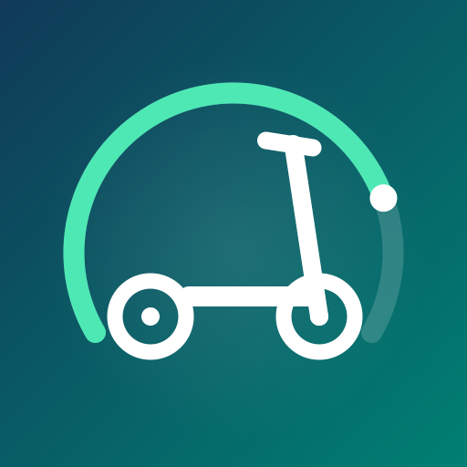

<p align="center"></p>

# ScooterRide

Track Segway Ninebot E3 Pro scooter rides on Apple Watch, separately from cycling workouts.

*An independent project, not affiliated with or endorsed by Segway-Ninebot.*

*Built with AI assistance (Claude).*

**Status:**
- **Phase 1** (manual ride tracking with GPS on Apple Watch) is tested on the owner's watch.
- **Phase 2** (iPhone sync, ride history with maps, deleting rides, Siri Shortcuts) is built and unit-tested. **Watch → iPhone sync and iPhone → watch deletion are tested on the owner's devices.** Siri, the iPhone End Ride shortcut and maps of a moving ride are not yet tested on devices.
- **Phase 3** (optional Smart Detection and Bluetooth discovery) is built and unit-tested, and installed on the owner's watch. Its features are **not yet tested on devices**.

## What Phase 2 adds

- **Sync:**
  - **How rides travel:** finished rides are copied from Apple Watch to iPhone with WatchConnectivity `transferFile`. The system queues these transfers and delivers them whenever the iPhone is reachable, even after either app has quit.
  - **Acknowledgements:** the watch re-sends a ride until the iPhone confirms it, retrying after failures, when the iPhone app appears, and when it becomes reachable. The watch's ride list shows *On iPhone* or *Waiting for iPhone*.
  - **Check-in:** queued transfers reach the iPhone app only while it's running, which it often isn't when the iPhone is locked. So whenever the watch app is open and the iPhone is in range, the watch asks the iPhone which of its rides it has. It asks when the app opens, when the iPhone comes into range, and about 2 s after each ride file arrives.
    - That message wakes the iPhone app in the background, even when the iPhone is locked, so it imports waiting rides and answers.
    - The answer also lists rides deleted on the iPhone.
    - The watch then re-sends only rides the iPhone is missing.
  - **Duplicates:** importing is idempotent, so the same ride arriving twice is harmless.
- **Ride history on iPhone:**
  - **List:** newest first, each with a map thumbnail of the route, distance, time, and max and average speed.
  - **Ride detail:** a full map with the route (a separate line for each segment between pauses) and start/end markers. It also shows ride time, distance, average and max speed, start and end times, pauses, and GPS fixes kept or filtered out, with reasons.
- **Deleting rides:** swipe a ride or use **Delete Ride** in its detail screen, then confirm. The ride is deleted from iPhone, and Apple Watch is asked to delete its copy too. The request is queued if the watch is away, and the watch's next check-in catches it as well. Deleted rides are remembered, so a late transfer can never bring one back.
- **Siri and Shortcuts:**
  - **On Apple Watch:** *“Start a scooter ride in ScooterRide”* and *“End my scooter ride in ScooterRide”*. Start opens the app, because location permission and GPS need it on screen. Both appear in the watch's Shortcuts app; on Apple Watch Ultra you can assign *Start Ride* to the Action button (Settings → Action Button → Shortcut). That last part is not yet tested.
  - **On iPhone:** *“End my scooter ride in ScooterRide”* asks the watch to end and save the ride. It only works while the watch app is reachable; otherwise it says so instead of queueing a request that could end a ride later than intended. Watch-side end requests older than 60 s are ignored.
  - **No Start Ride on iPhone:** there's no supported way to start a ride on the watch from iPhone in the background without a HealthKit workout session, which ScooterRide deliberately doesn't use. Start rides on the watch: tap, Siri, or the Action button.
- **Pre-start fixes are ignored.** A GPS fix timestamped before Start or Resume is no longer recorded. This was found in the first device test.
- **Maps** use Apple Maps tiles over the network; your ride data never leaves your devices.

## What Phase 3 adds

Smart Detection is **off by default** and has its own switch on each device. It only ever **suggests**; nothing starts, ends or changes a ride without a tap. Every result is labeled as an estimate.

- **On Apple Watch** (switch on the start screen):
  - **Stop suggestion:** during a ride, after 3 minutes without riding movement, the watch taps your wrist and asks *End ride?* (Save Ride / Keep Riding). It shows an alert in the app, or a notification with *End & Save* and *Keep Riding* when the wrist is down.
    - The evidence must be continuous: slow GPS speed with motion not riding-like, or, without GPS speed, motion saying stationary or walking.
    - *Keep Riding* snoozes it for 10 minutes. It never fires while paused.
  - **Start suggestion:** only while ScooterRide is open and not recording. It suggests *Start* when GPS shows a sustained 6–23 mph, or when the scooter you picked is advertising nearby (one 15-second scan per app opening). *Not now* snoozes it for 5 minutes.
  - **Motion during rides:** Core Motion activity time (cycling, automotive, walking and so on) is saved with each ride.
  - **Ride-type label** on the summary.
- **On iPhone** (Settings in the History screen's info button):
  - **Ride-type labels:** *Scooter-like riding*, *Mostly walking*, *Faster than an E3 Pro (car?)* or *Not enough movement to tell*, with the numbers behind each. GPS speed can't tell a scooter from a bicycle.
  - **Riding alerts:** optional, and they need *Always* location. iOS wakes the app after significant location changes (roughly 500 m). If the last minutes of iPhone motion look like riding, ScooterRide sends a notification suggesting a ride on Apple Watch.
    - It skips: during a recorded ride, more than once in 30 minutes, above 25 mph, and *automotive* motion without a speed to check.
    - The Settings screen shows the last decision and why.
- **Bluetooth discovery** (both devices, one shared implementation in RideKit):
  - **Scanning:** only when you tap Scan, for 20 s. It lists name, signal, connectable, transmit power, maker ID and advertised services, with standard names.
  - **Masked names:** names that look like serial numbers (this E3 Pro advertises its serial) are masked, like `ZX…CD56`, and never stored.
  - **Read standard info:** connects only when you tap it, reads only Device Information (not the Serial Number or System ID) and Battery Level, then disconnects.
  - **Never writes or subscribes.** No notification subscriptions, no vendor channel, and no setting changes. A unit test fails if the scanner's source ever gains a write or subscribe call.
- **Why the watch can't detect a ride start in the background:** watchOS has no significant-change location, region monitoring or `CLMonitor` (checked in the watchOS 27.2 SDK headers). So the watch can only notice riding while ScooterRide is open; the iPhone alert covers the rest.

## What it does (Phase 1)

- **Controls:** Start Ride, Pause, Resume and End Ride on Apple Watch. Ending asks Save / Discard / Keep Riding.
- **Speed display:** a large GPS-estimated speed in mph, labelled *GPS EST.* with a GPS signal dot.
- **Ride metrics:** time (pauses excluded), distance, current, average and maximum GPS-estimated speed.
- **Route recording:** GPS route points are recorded and stored locally. Inaccurate, stale, out-of-order and implausible fixes are filtered out.
- **Crash protection:** the ride in progress is checkpointed every 30 s. If watchOS ends the app mid-ride, the ride is recovered on next launch.
- **Recent rides:** a list of saved rides on the watch.

## What it never does

- **No workouts:** no HealthKit is used at all. Rides are never saved as workouts, cycling or otherwise, and add no exercise minutes or calories.
- **Apple's workout detection is untouched:** ScooterRide cannot change how Apple Watch classifies motion, and there is no public API to retrain it or to silence only cycling prompts. If your watch suggests *Outdoor Cycling* while you ride, you can turn the prompt off yourself in the Watch app on iPhone: **Workout > Start Workout Reminder**. Menu names can vary by watchOS version. This turns off start reminders for every workout type.
- **No account, servers or cloud.** Rides stay in the app's own storage on the device.
- **No scooter control.** Speed comes from GPS, not from the scooter. The E3 Pro has no documented public Bluetooth API; see *Known limitations*. The Bluetooth screen only reads standard information when you tap, and never writes.

## Project layout

```
ScooterRide.xcodeproj          iOS app + watchOS app (folder-synced groups, shared schemes)
Packages/RideKit/              Swift package: units, GPS filter, speed estimator, ride state
                               machine, metrics, JSON storage, sync logic, Smart Detection,
                               read-only Bluetooth scanner and shared Bluetooth screens. No HealthKit.
  Tests/RideKitTests/          Unit tests (Swift Testing), synthetic GPS tracks only
ScooterRideWatch/              watchOS app: LocationService (Core Location), RideViewModel, WatchSync
                               (WatchConnectivity), SmartDetection, RideIntents (App Intents + Siri), views
ScooterRide/                   iOS app: RideLibrary, PhoneSync (WatchConnectivity), history, detail
                               with MapKit, RouteSnapshotter (list thumbnails), RidingAlerts, PhoneIntents,
                               About/Settings
Config/ScooterRideWatch-Info.plist   adds the "location" background mode for the watch app
scripts/build.sh, scripts/test.sh    command-line build and test
scripts/make-icon.swift              draws the app icon (Core Graphics; `swift scripts/make-icon.swift out.png 1024`)
docs/icon.png                        the icon at 512 px, for this README
```

**How the pieces fit together:**
1. `LocationService` turns each `CLLocation` into a `LocationSample`.
2. `RideRecorder` (in RideKit) filters each sample, estimates speed, accumulates distance and tracks the ride state (idle → active ⇄ paused → ended).
3. `RideStore` writes each finished ride as one JSON file, plus a checkpoint file while a ride is in progress.

## Requirements

- Xcode 26.6 or later. Built here with Xcode 26.6 (iOS/watchOS 26.5 SDKs) and Xcode 27.2 (iOS/watchOS 27.2 SDKs).
- iPhone with iOS 17 or later, and a paired Apple Watch with watchOS 10 or later.
- An Apple ID added to Xcode (*Xcode > Settings > Accounts*). A free Personal Team works; its installs expire after 7 days.

## Install on your iPhone and Apple Watch (exact Xcode steps)

1. On the Mac with Xcode, open `ScooterRide.xcodeproj`.
2. In the Project navigator, select the **ScooterRide** project, then the **ScooterRide** target. Open **Signing & Capabilities**, keep **Automatically manage signing** on, and choose your **Team**.
3. Select the **ScooterRideWatch** target and choose the **same Team**.
4. If Xcode reports the bundle identifier is unavailable, change the prefix `com.saipraneethmedisetti` to something unique, in three places:
   - the **ScooterRide** target's bundle identifier
   - the **ScooterRideWatch** target's bundle identifier (keep the `.watchkitapp` suffix)
   - the ScooterRideWatch build setting **WKCompanionAppBundleIdentifier**, which must equal the iPhone app's identifier
5. Connect the iPhone with a cable, or use the same Wi-Fi network after pairing it in *Window > Devices and Simulators*. Unlock it and tap **Trust**.
6. Turn on **Developer Mode** where macOS/iOS asks for it. iPhone: *Settings > Privacy & Security > Developer Mode*, then restart. Apple Watch: *Settings > Privacy & Security > Developer Mode*, which appears after Xcode has seen the watch.
7. **Install the iPhone app:** choose the **ScooterRide** scheme and your **iPhone** as the destination, then press **Run** (⌘R).
8. **Install the watch app:** choose the **ScooterRideWatch** scheme and your **Apple Watch** as the destination, then press **Run**. The first install to a watch can take several minutes.
9. With a Personal Team, the first launch may say the developer is untrusted. Fix it on iPhone: *Settings > General > VPN & Device Management*, then trust your Apple ID.
10. On the watch, open ScooterRide, tap **Start Ride**, and allow location access **While Using the App**.

**Before installing a new build,** open ScooterRide on the watch near the iPhone, and check that its rides say *On iPhone*. In testing, installing a new build reset the watch app's storage and erased a ride that hadn't synced yet.

## Run in the Simulator

Choose the **ScooterRideWatch** scheme and a watch simulator. After tapping Start Ride, simulate movement in the Simulator app: *Features > Location > City Bicycle Ride* or *Freeway Drive*.

Simulated locations exercise the code path. They don't reflect real GPS quality on a moving scooter.

## Tests

```bash
scripts/test.sh
```

```bash
scripts/build.sh
```

`test.sh` runs the RideKit unit tests on macOS:
- **Speed:** unit conversions, Doppler vs. derived speed, median smoothing, a single spike ignored for max speed, stopped threshold.
- **Distance:** straight-line accuracy, stationary jitter ignored, slow movement still counted, pauses excluded.
- **Session state:** valid lifecycle, invalid transitions throw, active duration excludes pauses.
- **GPS filtering:** invalid, inaccurate, stale, out-of-order, duplicate, implausible speed and jump.
- **Persistence:** round trip, newest-first listing, corrupt files skipped, delete, atomic overwrite, checkpoint recovery.
- **Sync:** messages, deciding what to send, sync state, importing (duplicates, deleted rides, bad input), and the watch's check-in. Also route geometry for the maps.

All GPS data in the tests is **synthetic**.

`build.sh` builds the watch app and the iPhone app (with the watch app embedded) for the simulators, and compiles both for devices without signing.

## Background location and battery

- **Background updates:** while a ride is active, the watch app uses the `location` background mode with `allowsBackgroundLocationUpdates` and a `CLBackgroundActivitySession` (watchOS 10+), so recording can continue when you lower your wrist. Apple's headers document these APIs for watchOS. On the owner's Ultra 2, fixes kept arriving about once a second through real 28- and 15-minute rides (largest gaps: 13 s and 1 s). The wrist position during those rides wasn't recorded.
- **Safety check:** the app checks that the background mode is present before enabling it. If it isn't, it falls back to foreground-only tracking instead of crashing.
- **Watch screen:** watchOS can still return to the watch face. Recording continues in the background, but the ScooterRide screen isn't kept in front.
- **Battery:** continuous GPS is among the most power-hungry things a watch does. Expect noticeably faster drain during rides, especially with **Precise GPS** on. No battery measurements have been made yet.
- **Saving battery:**
  - Turn **Precise GPS** off (about 10 m accuracy instead of best).
  - Pause when stopped for a while; GPS is off while paused.
  - End rides promptly.

## Known limitations

- **Speeds are GPS estimates.** They lag behind and differ from the scooter's speedometer, especially at low speed, under trees or between tall buildings.
- **Apple's workout detection** is out of the app's control (see above).
- **No scooter telemetry.** Earlier read-only Bluetooth investigation of this owner's US E3 Pro found only:
  - a proprietary Nordic UART data channel, undocumented and probably encrypted
  - a standard PnP ID
  - no standard battery, firmware or speed data
  
  The Bluetooth screen shows only standard, exposed information. It doesn't connect automatically and never changes settings. No firmware flashing, speed-limit changes or safety-feature changes, ever.
- **Smart Detection is an estimate.** Core Motion has no scooter activity, so a scooter may register as cycling, automotive or unknown. GPS speed can't tell a scooter from a bicycle. The watch notices riding only while ScooterRide is open, and the iPhone alert arrives only after roughly 500 m.
- **Development reinstalls can erase unsynced watch rides.** See the note after the install steps.
- **The check-in needs the watch app on screen.** If you lower your wrist right after saving, the ride is still delivered and imported once the iPhone app runs. The watch then shows *On iPhone* the next time you open it.
- **App icon** is an original design drawn in code (`scripts/make-icon.swift`). It has no dark or tinted variants yet.
- **Physical-device validation is partial.** See *Testing status*.

## Testing status (only results that actually ran)

Phase 1, 2026-11-09, on a Mac mini (Apple M4, macOS 27.0.1, Xcode 26.6, Swift 6.3.3):

| Check | Result |
|---|---|
| `scripts/test.sh`: 32 RideKit unit tests in 6 suites (synthetic GPS data) | **Passed**, no warnings |
| `xcodebuild`: watchOS app for the watchOS Simulator | **Succeeded**, no compiler warnings |
| `xcodebuild`: iOS app with embedded watch app, iOS Simulator | **Succeeded**, no compiler warnings |
| `xcodebuild`: iOS + watch apps for devices (compile only, `CODE_SIGNING_ALLOWED=NO`) | **Succeeded**. Watch binary is `arm64_32 arm64` |
| Built watch `Info.plist` | Verified: `UIBackgroundModes = [location]`, location usage text, `WKCompanionAppBundleIdentifier`, minimum watchOS 10.0 |
| Watch app on the Apple Watch Ultra 3 (49 mm) **simulator**, watchOS 26.5 | Installed, launched, still running after 6 s, no crash report. Start screen rendered correctly (screenshot) |

**Physical device, 2026-11-09:**

| Check | Result |
|---|---|
| Install on the owner's **Apple Watch Ultra 2 (watchOS 27.2)** from Xcode 26.6 with the Personal Team, over Wi-Fi. Developer Mode had to be enabled on iPhone and watch first | **Installed**: `ScooterRide 0.1 (1)`, confirmed with `devicectl device info apps` |
| App launch on the watch | **Running**, confirmed with `devicectl device info processes`. The owner confirmed it opened |
| Test recording 1: 67 s, owner essentially stationary (track stayed within 6.9 m of the start). Ride file copied off the watch with `devicectl device copy from`; analyzed as aggregates only | 57 fixes at 1 Hz (largest gap 6 s, during GPS warm-up). 0 fixes rejected. Median accuracy 2.9 m (90th percentile 9.3 m). Doppler speed on 54 of 57 fixes. Raw point-to-point jitter of 41 m was correctly recorded as **0 m distance**. Max 1.4 mph. Saved and listed correctly. **Not a test of moving rides or wrist-down recording** |

**Found in testing:** the first accepted fix was timestamped 0.4 s before Start. **Fixed in Phase 2:** fixes timestamped before Start or Resume are now rejected (`beforeSegmentStart`, unit-tested).

**Phase 2, 2026-11-09, Mac mini (same toolchain):**

| Check | Result |
|---|---|
| `scripts/test.sh`: **44 tests in 10 suites** (12 new: pre-start rule, sync messages, send planning, sync state, import edge cases, route geometry) | **Passed**, no warnings |
| `scripts/build.sh`: watch app (Simulator), iOS + embedded watch app (Simulator), both for devices (unsigned) | **All succeeded**, no warnings |
| iPhone app on the iPhone 17 Pro Max **simulator** | Launched; *Scooter Rides* empty state rendered correctly (screenshot) |
| `scripts/sim-sync-e2e.sh`: watch → iPhone sync between paired **simulators** with a synthetic ride | **Inconclusive (simulator problem).** The watch app activated WatchConnectivity, saw the iPhone as reachable and called `transferFile`. The iPhone simulator's IDS transport then failed repeatedly ("XPC has informed us that a fatal error has occured"), so the file never arrived, even after restarting both simulators. This showed that a first send can happen before the iPhone side is ready, so retries were added (on reachability, on companion-app install, and 60 s after a failed transfer) |

**Phase 2 rebuild on Xcode 27.2, 2026-11-09, Mac mini (Xcode 27.2, Swift 6.4.2, iOS/watchOS 27.2 SDKs).** Xcode had been updated, and its *recommended settings* were accepted. That added the standard warning flags and moved the team ID to the project level.

| Check | Result |
|---|---|
| `scripts/test.sh` | **44 tests in 10 suites passed** |
| `scripts/build.sh` | **All 3 builds succeeded**, no compiler warnings or errors |

**Phase 2, physical devices, 2026-11-09:**

| Check | Result |
|---|---|
| Install the iPhone app on the owner's **iPhone 16 Pro Max (iOS 27.2)** and the watch app on the **Apple Watch Ultra 2 (watchOS 27.2)** from Xcode 27.2, Personal Team, over Wi-Fi | **Both installed** (`ScooterRide 0.1 (1)`) and **running**, confirmed with `devicectl device info apps` and `processes` |
| Watch data after the install | **The watch app's storage was reset.** Every folder in its data container was new, created one minute after the iPhone app's. This erased the Phase 1 test ride, which hadn't synced. Likely cause: installing the iPhone app, which embeds the watch app, replaced the watch app. **Not confirmed** |
| **Watch → iPhone sync with a real ride.** The Phase 1 ride file (copied off the watch earlier) was put back in the watch app's Rides folder with `devicectl device copy to`. The watch app was then relaunched with `devicectl device process launch` | **Passed.** The ride was on the iPhone at the first check, under a minute after the relaunch. The iPhone's copy is **identical** to the watch's (JSON comparison: same ID, 57 points). The watch's `sync-state.json` lists the ride as **acknowledged**. The send was triggered by the app launch; a ride saved with **End** has not been tested yet |
| The synced ride on screen (owner's check) | The iPhone list and detail screen showed it, and the watch showed **On iPhone** |

**Phase 2, physical devices, 2026-11-10** (both devices on iOS/watchOS 27.2.1 after an update partway through; each step was monitored live from the Mac mini):

| Check | Result |
|---|---|
| New 32 s ride saved with **End → Save Ride**, watch app on screen. When checked 10 minutes later, the iPhone was locked, so its app was suspended | **Partly passed.** A checkpoint appeared at Start and the ride file at Save. The ride reached the iPhone about 15 s after Save, identical to the watch's copy. **The watch never received the iPhone's acknowledgement** (still missing after 13 min) and kept showing *Waiting for iPhone*. Copies the watch re-sent when it was reopened piled up undelivered in the iPhone's WatchConnectivity inbox (3–4 copies) while the iPhone app was suspended. The cause was found later, under *Check-in fix*. An earlier test ride was lost because it was ended with *Discard Ride* |
| The owner accidentally uninstalled the watch app after the 27.2.1 update. Reinstalled from the existing signed build with `devicectl device install app` | **Installed** in 4 s. Developer Mode stayed on through the update. The uninstall erased the watch's rides; both were still on the iPhone |
| New 33 s ride saved with End → Save, **both apps on screen** | **Passed.** Saved at 12:16:56, on the iPhone at 12:16:57 (identical), acknowledged on the watch at 12:16:58. One fix dated before Start was rejected (`beforeSegmentStart`), confirming the Phase 2 fix on a device |
| **Deletion:** that ride deleted on the iPhone (swipe, then confirm), watch app on screen | **Passed.** Gone from both devices in the same check, within about 10 s. The watch's `sync-state.json` records it as deleted, the iPhone keeps a deletion record, and the other two rides were untouched |

**Check-in fix, 2026-11-10** (for the lost acknowledgement above):

| Check | Result |
|---|---|
| **Reproduction, old build:** 32 s ride saved with the **iPhone locked** (`devicectl` lock state: passcode required), watch app on screen, monitored for 5 min | **Reproduced.** The ride reached the iPhone's WatchConnectivity inbox in 1 s but was **never imported**: the iPhone app wasn't running. The watch kept re-sending: 4 copies piled up in the inbox, and no acknowledgement came back. This was the cause of the lost acknowledgement |
| `scripts/test.sh` (Xcode 27.2): **50 tests in 11 suites**. The 6 new ones cover check-in messages, message size, request building, the iPhone's reply, and applying the reply on the watch | **Passed**, no warnings |
| `scripts/build.sh` | **All 3 builds succeeded, 0 warnings** |
| Signed build over SSH | **Not possible.** Profiles were found, but codesign failed with `errSecInternalComponent`: an SSH session can't use the signing key without the login password. Installed from Xcode on the Mac mini instead |
| Install of both fixed apps from Xcode | **Installed and running.** Both bundles contain the check-in code. The new iPhone app imported the stuck ride from its inbox on launch. The watch app **kept its data** this time |
| **Fix verified:** 32 s ride saved with the **iPhone locked** (passcode required), watch app on screen | **Passed.** Saved at 12:43:52; within 2 s the iPhone had **imported it while locked** (inbox empty), the copies were identical, and the watch had recorded the acknowledgement |

**Not yet done for Phase 2:**
- sync when the iPhone is out of range for a while, then comes back
- the check-in's effect on deletions made while the watch was away
- Siri phrases and the Action button
- the iPhone End Ride shortcut
- map thumbnails with a moving route

**Phase 3, 2026-11-10, Mac mini (Xcode 27.2):**

| Check | Result |
|---|---|
| `scripts/test.sh`: 21 new tests (motion, stop and start suggestions, ride type, riding alert, Bluetooth names, PnP ID, masking, no-write guard) | **71 tests in 17 suites passed** |
| `scripts/build.sh` | **All 3 builds succeeded, 0 warnings** |
| Built Info.plist files | iPhone: location (when in use and Always), motion and Bluetooth texts present. Watch: location, motion and Bluetooth texts present, plus `UIBackgroundModes = [location]` |
| Both apps launched in paired **simulators** (iPhone 17 Pro Max and Apple Watch) | Still running after 8 s; no crash |
| Installed on the owner's watch from Xcode | The watch app saved its Smart Detection setting (currently off), which only the Phase 3 build does. The iPhone was unreachable when checked |

**Real rides, 2026-11-10** (owner's Apple Watch Ultra 2, Smart Detection off, so no motion data; totals only):

| Ride | Result |
|---|---|
| 28:45, 2.36 mi | Max **19.2 mph**, median moving speed 17.8 mph, 1,712 fixes (largest gap 13 s), 15 rejected. Synced and acknowledged. Estimate: scooter-like |
| 15:24, 2.44 mi | Max **19.2 mph**, median moving speed 17.9 mph, 917 fixes (one every second), 10 rejected. Synced and acknowledged. Estimate: scooter-like |
| 24 s, standing still | **Bug found: max speed 60.1 mph.** Two warm-up fixes 0.09 s apart with 4.9 m of jitter were divided into 120 mph. The fixes themselves were legitimately kept, being within their accuracy. A median of only two readings then averaged that spike with 0, and it counted toward the max |

**Fixed** (Phase 1 code):
- Speed is derived from position only for fixes at least 0.9 s apart, and never above 40 mph.
- Speed is shown, saved and counted toward the max only once all three readings in the median are present.
- A regression test replays the shape of that recording. **74 tests pass; 3 builds succeed.**
- The fix is **not yet installed** on the devices. The affected ride keeps its wrong max.

**Not yet done for Phase 3:** the permission prompts on devices, a stop suggestion during a ride, a start suggestion by GPS or Bluetooth, motion data and ride-type labels with Smart Detection on, both Bluetooth screens with the scooter, and an iPhone riding alert on a real trip.

**Not yet done:**
- the location permission prompt after the reinstall
- battery impact
- comparing GPS speed with the scooter's speedometer directly (the two real rides topped out at 19.2 mph against the E3 Pro's 20 mph limit)
- tapping Start Ride in the simulator, or replaying a simulated route

### Troubleshooting Developer Mode on Apple Watch

The watch's Developer Mode switch appears only after Xcode connects to the watch. Xcode reaches the watch **over Wi-Fi**, not through the iPhone's cable. If it's missing:
1. Turn on Developer Mode on the iPhone first. Connect it by cable, then go to Settings → Privacy & Security → Developer Mode.
2. Put the watch on the same Wi-Fi network as the Mac, and keep it awake and unlocked.
3. Open Xcode → Window → Devices and Simulators and wait for the watch to connect.
4. Restart the Mac, iPhone and watch if it stays unavailable.
